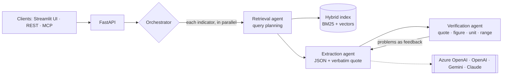
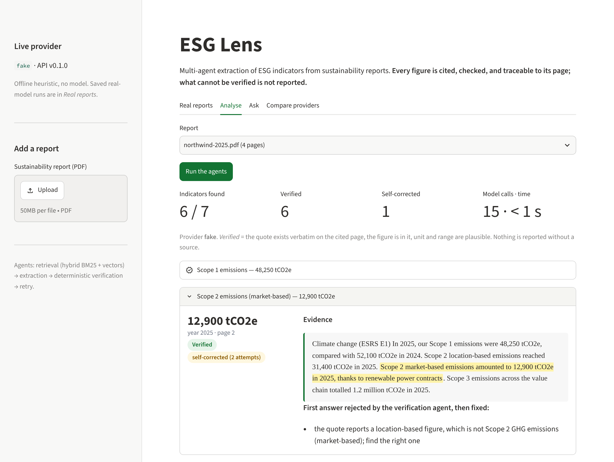

# ESG Lens

[](https://github.com/<your-github-user>/esg-lens/actions/workflows/ci.yml)
 

**A production-grade, multi-agent system that extracts ESG indicators from sustainability reports,
cites every figure and refuses to report what it cannot verify.** Runs on Azure OpenAI, OpenAI, Gemini or
Claude, deploys keyless on Azure (Bicep) or Google Cloud, and exposes its tools to other agents over MCP.

- **Agents that check their own work**: retrieval, extraction and verification agents with a
  self-correction loop. No figure is accepted unless its quote exists on the cited page.
- **Evaluation built in**: gold sets, accuracy, citation accuracy, hallucination rate, latency and
  cost, and one command to compare providers.
- **Multi-cloud and keyless**: managed identities everywhere, model keys disabled, infrastructure as code.
- **Usable by other agents**: an MCP server for Claude, Copilot or any MCP client.

## What this project demonstrates

| Skill | Where to look |
|---|---|
| Agent design and orchestration (planning, tool use, self-correction, parallelism) | [`src/esg_lens/agents/`](src/esg_lens/agents) |
| Retrieval-augmented generation with hybrid search (BM25 + embeddings) | [`index.py`](src/esg_lens/index.py), [`agents/qa.py`](src/esg_lens/agents/qa.py) |
| Guarding against hallucinations with deterministic verification | [`agents/verification.py`](src/esg_lens/agents/verification.py) |
| LLM evaluation: gold sets, metrics, multi-provider leaderboard, cost estimates | [`evaluation.py`](src/esg_lens/evaluation.py), [`benchmark.py`](src/esg_lens/benchmark.py) |
| Provider-agnostic design: Azure OpenAI, OpenAI, Gemini, Claude, offline mode | [`src/esg_lens/llm/`](src/esg_lens/llm) |
| Cloud architecture on Azure: Container Apps, Azure OpenAI, Key Vault, ACR, managed identity, least privilege | [`infra/azure/main.bicep`](infra/azure/main.bicep), [`docs/architecture.md`](docs/architecture.md) |
| Cloud deployment on Google Cloud: Cloud Run, Vertex AI, service accounts | [`deploy/gcp/deploy.sh`](deploy/gcp/deploy.sh) |
| API security: bearer token from Key Vault, Entra ID option, constant-time checks | [`api.py`](src/esg_lens/api.py) |
| Model Context Protocol server | [`mcp_server.py`](src/esg_lens/mcp_server.py) |
| Engineering practice: tests, lint, CI, Docker, IaC validation | [`tests/`](tests), [`.github/workflows/ci.yml`](.github/workflows/ci.yml) |

## Why this matters

Since 2024 the EU Corporate Sustainability Reporting Directive (CSRD) requires thousands of companies
to publish detailed ESG data. Analysts still copy figures from long PDFs by hand, and generic
"chat with your PDF" tools invent numbers. In this domain a confident wrong figure is worse than no
answer, so ESG Lens is built around one rule: **cite it, verify it, or say it is not disclosed**.

## Architecture



Design decisions and trade-offs: [docs/architecture.md](docs/architecture.md).

**Azure reference architecture** ([infra/azure/main.bicep](infra/azure/main.bicep)): Container Apps,
Azure OpenAI with **local keys disabled**, Key Vault, Container Registry and Log Analytics, all reached
through one user-assigned managed identity with least-privilege roles; optional Entra ID sign-in at
the ingress. **Google Cloud**: Cloud Run with a dedicated service account calling Vertex AI, private service.

## Quick start (offline, no API key)

```bash
pip install -e ".[dev,ui,mcp]"
esg-lens demo                            # fictional report + full agent pipeline
esg-lens eval data/gold/sample.jsonl
pytest -q
uvicorn esg_lens.api:app --reload        # http://localhost:8000/docs
streamlit run ui/app.py
```

On Windows (PowerShell), activate the environment with `.venv\Scripts\Activate.ps1`
(if blocked: `Set-ExecutionPolicy -Scope CurrentUser RemoteSigned`). The commands above work as is;
`make` and the `deploy/*.sh` scripts need Git Bash or WSL. CI runs the tests on Linux and Windows.

The offline provider is a keyword heuristic, not a model: it lets the whole system, the tests and the
CI run without credentials.

## Interface

```powershell
.\scripts\ui.ps1        # Windows: starts the API and the Streamlit app together (Ctrl+C stops both)
```
On macOS / Linux: `uvicorn esg_lens.api:app &` then `streamlit run ui/app.py`.



- **Real reports**: the saved runs on public CSRD reports, with their headline numbers and the score
  against the human-checked values. Needs no API key.
- **Analyse**: upload a PDF and run the agents live. Each indicator shows its value, its status
  (verified, not disclosed, rejected), the cited sentence highlighted in its page, and the
  self-correction trace when the verification agent sent a first answer back.
- **Ask**: questions answered with citations.
- **Compare providers**: the same report side by side across models, against the human check.

## Use a real model

```bash
cp .env.example .env
pip install -e ".[azure]"                # or [gemini] / [anthropic]
```

| Provider | Configuration | Authentication |
|---|---|---|
| Azure OpenAI | `ESG_PROVIDER=azure`, `ESG_AZURE_ENDPOINT`, deployment names | `az login` locally, managed identity in Azure |
| Gemini | `ESG_PROVIDER=gemini`, `ESG_GCP_PROJECT` | Application Default Credentials, service account on Cloud Run |
| Claude | `ESG_PROVIDER=anthropic` | `ANTHROPIC_API_KEY` |
| OpenAI | `ESG_PROVIDER=openai` | `OPENAI_API_KEY` |

Default models (November 2026), each overridable with one environment variable:

| Provider | Generation | Embeddings | Override |
|---|---|---|---|
| OpenAI | `gpt-5.4-mini` | `text-embedding-3-small` | `ESG_OPENAI_MODEL`, `ESG_OPENAI_EMBEDDING_MODEL` |
| Azure OpenAI (v1 API) | `gpt-5.4-mini` | `text-embedding-3-small` | `ESG_AZURE_CHAT_DEPLOYMENT`, `ESG_AZURE_EMBEDDING_DEPLOYMENT` |
| Gemini | `gemini-3.8-flash` | `gemini-embedding-001` | `ESG_GEMINI_MODEL`, `ESG_GEMINI_EMBEDDING_MODEL` |
| Claude | `claude-sonnet-5-5` | local hashed vectors + BM25 | `ESG_ANTHROPIC_MODEL` |

Built for real reports and real cloud quotas:

- **Units and number formats**: tCO2e / ktCO2e / MtCO2e, kWh to TWh, GJ / TJ, m³ / megalitres, `1,234.5`,
  `1 234,5`, `1.234.567`, "1.2 million"; each indicator is converted to one unit after verification.
- **Messy PDF text**: quotes are matched after Unicode normalisation (ligatures, CO₂, curly quotes, dashes,
  non-breaking spaces) and de-hyphenation; a quote found on a neighbouring page fixes the page number,
  an invented quote is still rejected.
- **Quotas and outages**: rate limits (429), 5xx errors and timeouts are retried with exponential backoff
  and jitter, once, for every provider; client errors fail fast.
- **Model changes**: reasoning models that refuse a custom temperature are detected and the request is
  replayed without it. Each adapter is tested against a mock server with the real vendor SDK.

## Test on real reports

Three public CSRD sustainability statements (Metso, Scania, Holcim, financial year 2025) are listed in
[`data/reports/catalog.json`](data/reports/catalog.json), from the easiest to the hardest. One command
downloads them, runs the agents on each and saves the results:

```powershell
.\scripts\run-real.ps1                       # Windows, Gemini (asks for the API key, hidden)
.\scripts\run-real.ps1 -Provider anthropic   # or Claude; -Provider azure after `az login`
```
```bash
./scripts/run-real.sh gemini                  # macOS / Linux
```

Or step by step: `esg-lens fetch`, then `esg-lens run --all` (or `esg-lens run data/reports/metso-2025.pdf`).
Results go to `results/<provider>/`: one `.csv` per report (opens in Excel), the full `.json`, and a
`SUMMARY.md`. Each value is then checked by hand on the cited page; checked values become the real gold
set (`data/gold/real.jsonl`) used by `esg-lens eval` and `esg-lens bench`.

## Evaluation

```bash
esg-lens eval data/gold/sample.jsonl                                        # one provider
esg-lens bench data/gold/sample.jsonl --providers openai,azure,gemini,anthropic   # leaderboard
esg-lens annotate data/reports/<report>.pdf --out data/gold/mine.jsonl      # draft gold lines, human-reviewed
```

The repository ships a fictional report (`esg-lens demo` generates it) with the traps found in real
reports: previous-year figures next to current ones, location- vs market-based Scope 2, energy in GWh,
an undisclosed indicator. Annotation rules for real reports: [docs/benchmark-protocol.md](docs/benchmark-protocol.md).

| Provider | Accuracy | Citation accuracy | Hallucination rate | Model calls / report |
|---|---|---|---|---|
| Offline heuristic (not a model, plumbing check) | 100 % | 100 % | 0 % | 15 |

The heuristic first falls into the Scope 2 trap (it returns the location-based figure). The verification
agent rejects it, sends the problem back as feedback, and the retry returns the market-based figure:
the self-correction loop at work (`attempts` and `corrected_issues` in the output). On a toy report this
is expected; real reports are where the models are tested.
Run `esg-lens bench` with your own credentials to add real models to this table.

### First real report: Metso, sustainability statement 2025

7 indicators, each checked by hand against the cited page ([`data/gold/real.jsonl`](data/gold/real.jsonl)).
Saved run: [`results/gemini/`](results/gemini).

| Provider | Model | Correct vs human check | Verified by the agents | Invented | Model calls | Time |
|---|---|---|---|---|---|---|
| Gemini (free tier) | `gemini-3.5-flash-lite` | 7 / 7 | 6 / 6 disclosed | 0 | 15 | 66 s |

- Scope 2: the market-based figure (1,717 tCO2e) was chosen over the location-based one printed on the
  line above it (84,534 tCO2e), and the 2025 column over the restated 2024 figures.
- Water withdrawal: correctly reported as not disclosed. Metso publishes water *consumption*, a different
  ESRS E3 metric, and the system did not substitute it.
- What the real report taught us: the model quoted *"In 2025, the ratio was 19%/81%"* for women in
  management. The value was right, but the verification agent rejected it, because the indicator is named
  in the previous sentence, not in the quote. The rule now accepts the indicator in the quote or the
  sentence right before it (never further), and `esg-lens reverify` re-checked the saved run with the new
  rule, without calling the model again.
- Indexing respected the free-tier quota (100 embedded texts per minute); `503` errors from the provider
  were absorbed by the retry logic.

One report is a smoke test, not a benchmark: Scania and Holcim (harder layouts, Mt CO2e, combined scopes)
and the other providers come next, with `esg-lens eval data/gold/real.jsonl`.

## Use it from Claude (MCP)

```json
{ "mcpServers": { "esg-lens": { "command": "esg-lens-mcp", "env": { "ESG_PROVIDER": "anthropic" } } } }
```

Tools: `list_indicators`, `list_reports`, `ingest_report`, `extract_indicators`, `ask_report`.
Every result carries page citations and a verification status, so the calling agent does not have to
trust its own reading of the PDF. HTTP transport: `esg-lens-mcp --http --port 8001`.

## Deploy

```bash
bash deploy/azure/deploy.sh               # Bicep: Container Apps + Azure OpenAI (keyless) + Key Vault
PROJECT=my-project bash deploy/gcp/deploy.sh   # Cloud Run + Vertex AI, private service
```

The API requires `Authorization: Bearer <token>` whenever `ESG_API_TOKEN` is set (it is, in Azure,
from Key Vault); `/health` stays public for probes.

## Project layout

```
src/esg_lens/
  agents/          retrieval, extraction, verification, orchestrator, question answering
  llm/             provider interface: Azure OpenAI, OpenAI, Gemini, Claude, offline
  ingest.py        PDF parsing, page-aware chunking
  index.py         hybrid BM25 + vector retrieval
  evaluation.py    metrics on a gold set
  benchmark.py     human-in-the-loop annotation, multi-provider leaderboard
  api.py           FastAPI service (bearer-token protected)
  mcp_server.py    MCP server
infra/azure/       Bicep reference architecture
deploy/            Azure and Google Cloud deployment scripts
ui/app.py          Streamlit front-end
tests/             unit, API, MCP, robustness and provider-adapter tests (offline, no keys needed)
```

## Related work

ESG extraction with LLMs is an active research area; this project focuses on the engineering side
(verification, evaluation tooling, secure multi-cloud deployment, MCP) rather than on a new dataset.

- [A benchmark dataset for greenhouse gas emission extraction](https://www.nature.com/articles/s41597-025-05664-8) (Scientific Data, 2025)
- [ESGenius](https://arxiv.org/html/2506.01646), [ESG-Bench](https://arxiv.org/html/2603.13154), [SustainableQA](https://arxiv.org/html/2508.03000v2): ESG knowledge, hallucination and QA benchmarks
- [Auditing the Auditor](https://www.researchsquare.com/article/rs-11610550/v1) (preprint, 2026): extraction accuracy, hallucination and abstention of open-weight LLMs on 518 ESG reports; tables are a leading cause of errors
- [sustainability-kpi-benchmark](https://github.com/mohana-kamineni/sustainability-kpi-benchmark): rule-based vs direct LLM vs RAG extraction of ESRS KPIs

## Roadmap

- Table-aware extraction (Azure Document Intelligence, Gemini and Claude vision) to address the main error source reported in the literature
- Evaluation on a public gold set and on recent CSRD reports, across Claude, Gemini and GPT
- Azure AI Search / Vertex AI Search backends
- Agents on Microsoft Agent Framework and Google ADK, compared with the plain-Python orchestrator

## License

MIT
