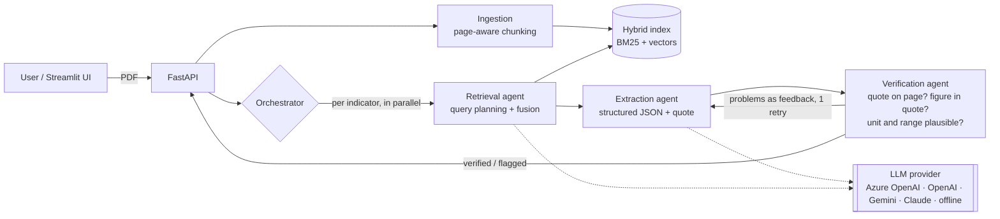
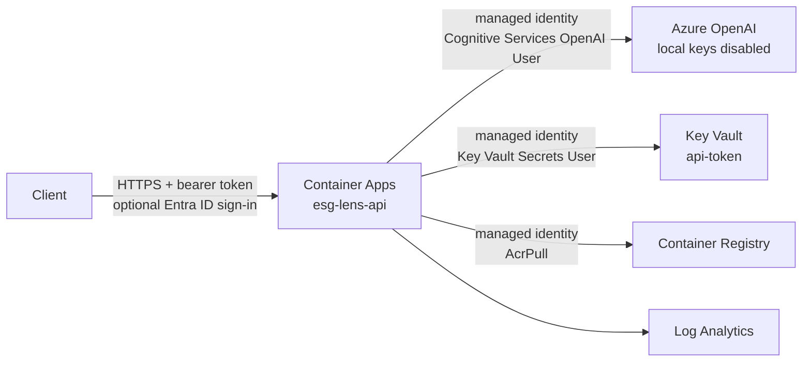

# Architecture

## Request flow

## Design decisions

| Decision | Why | Trade-off |
|---|---|---|
| One agent per responsibility (retrieve, extract, verify) instead of one big prompt | Each step can be tested, measured and improved on its own | More model calls per document (about 2 per indicator, plus retries) |
| Deterministic verification after the LLM | Catches hallucinated quotes and figures without paying for another model call | Only checks what can be checked mechanically; a wrong but well-quoted figure still needs evaluation |
| Self-correction loop (verification problems sent back as feedback) | Fixes most formatting and quoting errors on the second try | One extra call when the first answer fails |
| Hybrid retrieval (BM25 + dense) | ESG indicators are exact terms ("Scope 2 market-based"); pure semantic search confuses neighbours | Two scores to tune (`ESG_HYBRID_ALPHA`) |
| Page-aware chunks | Every value points to a page a human can check | Slightly more chunks than page-agnostic splitting |
| Provider interface + offline provider | Same agents on Azure, Gemini or Claude; CI runs without secrets | Provider-specific features (tool calling, structured outputs) are used through a common denominator |
| Indicators processed in parallel threads | Latency stays roughly constant as indicators are added | Higher burst of concurrent model calls (mind rate limits) |

## Mapping to managed cloud services

| Concern | This repo | Azure | Google Cloud |
|---|---|---|---|
| Models | `llm/` providers | Microsoft Foundry (Azure OpenAI) | Vertex AI (Gemini) |
| Retrieval index | `HybridIndex` (local) | Azure AI Search (hybrid + semantic ranker) | Vertex AI Search |
| PDF parsing | `pypdf` | Document Intelligence / Content Understanding | Document AI |
| Agents | `agents/` (plain Python) | Foundry Agent Service, Microsoft Agent Framework | Agent Development Kit (ADK) |
| Hosting | Docker image | Container Apps | Cloud Run |
| Identity | keyless by default | Managed identity + "Cognitive Services OpenAI User" role | Service account + `roles/aiplatform.user` |
| Secrets | none in code, `.env` locally | Key Vault | Secret Manager |
| Storage | `ESG_DATA_DIR` folder | Blob Storage / Azure Files | Cloud Storage |
| Monitoring | stdout logs | Azure Monitor, Application Insights | Cloud Logging, Cloud Trace |

## Azure reference architecture (infra/azure/main.bicep)

One user-assigned identity carries exactly three role assignments; the application uses no key or password
(the only shared key is the one Container Apps itself uses to ship logs to Log Analytics, managed by the platform).
`deploy/azure/deploy.sh` provisions with a placeholder image, builds the real image in ACR, then rolls
it out with the same template, so the infrastructure stays fully declarative.

## Security

- No API key is required in the cloud: managed identity (Azure) and service account (GCP), least-privilege roles.
- Azure OpenAI is deployed with `disableLocalAuth: true`: keys cannot be used even if leaked.
- The API requires a bearer token (from Key Vault in Azure), compared in constant time; `/health` stays public for probes.
- The Cloud Run service is deployed private (`--no-allow-unauthenticated`).
- Uploads are limited to PDF files of 50 MB; the container runs as a non-root user.
- Model outputs are never trusted as is: every figure is checked against the source text.
